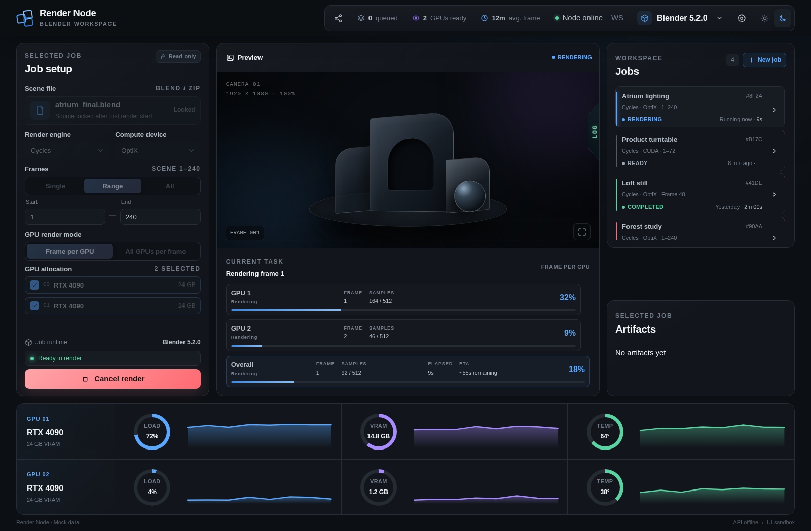

<p align="center">
  
</p>

<h1 align="center">Render Node</h1>

<p align="center">
  <strong>Blender rendering, managed from your browser.</strong><br>
  One node. A persistent queue. One or multiple GPUs.
</p>

<p align="center">
  <strong>English</strong> · <a href="docs/i18n/README.ru.md">Русский</a> · <a href="docs/i18n/README.zh-CN.md">简体中文</a>
</p>

<p align="center">
  <a href="https://github.com/NikkZhur/Render-Node/actions/workflows/release.yml"></a>
  
  
  
</p>

<p align="center">
  <a href="#features">Features</a> · <a href="#quick-start">Quick start</a> · <a href="#deployment">Deployment</a> · <a href="#documentation">Documentation</a>
</p>



<p align="center"><sub>Interface preview with demo data. Desktop and mobile layouts, light and dark themes.</sub></p>

Render Node turns a Linux machine or GPU Pod into a personal Blender rendering
workspace. Upload a scene, choose a runtime and compute resources, queue the
render, then follow its progress and download the results from the same page.

It is designed for **one operator and their own trusted scenes**. Jobs run in FIFO
order, with one active logical job at a time; that job can use several GPUs.

## Features

| | What you can do |
|---|---|
| **Scene → job** | Upload `.blend` or ZIP files, choose the render engine and frame range, edit a job and replace its scene before the first start. |
| **Queue controls** | Start, cancel, retry, or create an editable rerender copy. Keep job history in SQLite. |
| **GPU rendering** | Use CUDA or OptiX, select GPUs, and switch between frame distribution and a shared render process. CPU rendering is also available. |
| **Live feedback** | Follow overall and worker progress, elapsed time, estimated time remaining, previews, and Blender logs over WebSocket. |
| **Results** | Browse frames, download originals, frame ZIPs, and logs. Job history and artifact metadata survive backend restarts. |
| **Runtime & access** | Download, install, and explicitly activate Blender versions. Pair additional browsers with one-use invitation links. |

### Two GPU modes

| Mode | How it works | Intended use |
|---|---|---|
| **Frame per GPU** | Each selected GPU runs its own Blender process and renders assigned frames, respecting the scene's `frame_step`. | Animation frames rendered in parallel. |
| **All GPUs per frame** | One Blender process uses all selected GPUs for the current frame. | Multiple GPUs working on the same frame. |

CUDA/OptiX jobs with at least two GPUs default to **Frame per GPU**. CPU and
single-GPU jobs use the shared-process mode. One multi-GPU render remains one job
in the queue.

## Quick start

For local development on Linux, install **Python 3.13**, **uv**, **Node.js 22.12+**,
and **make**. Blender is not required to start the interface.

```bash
git clone https://github.com/NikkZhur/Render-Node.git
cd Render-Node

(cd backend && uv sync --frozen)
npm --prefix frontend ci

export RENDER_NODE_WORKSPACE="$HOME/render-node-data"
export RENDER_NODE_DATABASE_URL="sqlite+aiosqlite:///$RENDER_NODE_WORKSPACE/database/render-node.sqlite3"

make dev
```

Open **[localhost:5173](http://localhost:5173)**. `make dev` applies database
migrations, starts the API on port `8000`, waits for readiness, then starts Vite
on port `5173`. `Ctrl+C` stops both services. Data stays in the workspace selected
above; keep the two environment variables set when starting a new shell.

1. Open **Blender versions** and download, install, then activate a runtime.
2. Create a job and upload a `.blend` scene or ZIP archive with its assets.
3. Choose the engine, frames, and compute devices, then start the render.
4. Follow the preview and logs; download completed frames from **Artifacts**.

The first browser to open an unclaimed node gets access. Use **Pair another
device** for another browser. Backend restarts clear browser sessions, while
persistent jobs and files remain. The development server uses local resource
limits and is intended for a trusted development environment.

For a UI-only preview, run `npm --prefix frontend run dev:mock` and open the same
port. It uses demo data and does not render scenes.

See the [development guide](docs/development.md) for separate service startup,
configuration, unit checks, and Playwright scenarios.

## Deployment

The native installer targets **Ubuntu 22.04/24.04 x86_64 GPU Pods** with a working
`nvidia-smi`. Run it as root and expose port **8080** through the provider's HTTPS
proxy:

```bash
curl -fsSL https://raw.githubusercontent.com/NikkZhur/Render-Node/master/install.sh | bash
```

> [!NOTE]
> The installer requires a published stable GitHub Release bundle. No stable
> release is published yet; use the source quick start above in the meantime.
> See [releases](https://github.com/NikkZhur/Render-Node/releases) and the
> [publication guide](deploy/README.md#publication).

The installer prepares a release before switching to it and rolls back if
readiness fails. The repository also includes a Docker image recipe for platforms
that run the image directly. Both deployment paths require a writable, delegated
**cgroup v2** subtree for production rendering; HTTP readiness alone does not mean
the renderer is available.

[Installation, updates, rollback, pairing, and backups →](deploy/README.md)

## Inside the project

**React + Vite** · **TanStack Query + Zustand** · **FastAPI** ·
**SQLite + SQLAlchemy + Alembic** · **Blender subprocesses + NVIDIA NVML**

```text
frontend/   React interface, API client, and browser checks
backend/    FastAPI, job queue, Blender execution, storage, and tests
deploy/     Runtime scripts and deployment guide
scripts/    Development launcher, node management, and release packaging
docs/       Architecture, development guide, project status, and translations
```

One node, one API process, SQLite storage. No external queue or database service
is required. See the [architecture](docs/architecture.md) for module boundaries
and REST/WebSocket contracts.

## Documentation

| Guide | Contents | Language |
|---|---|---|
| [Development](docs/development.md) | Setup, environment, checks, and browser QA | English |
| [Deployment](deploy/README.md) | GPU Pod installation, Docker, updates, rollback, and backups | English |
| [Backend](backend/README.md) | API, runtime management, rendering, and security | English |
| [Architecture](docs/architecture.md) | Module responsibilities and system contracts | Russian |
| [Implementation status](docs/implementation-state.md) | Verified behavior, known issues, and outstanding checks | Russian |
| [Configuration](.env.example) | Environment variables and resource limits | English |

Real CUDA/OptiX smoke checks have run on one NVIDIA GPU. Multiple physical GPUs,
production installation/rollback, and delegated kernel cgroup v2 isolation still
need validation in the target environment. Fake Blender checks cover application
behavior; they do not replace those checks. The
[implementation status](docs/implementation-state.md) records the current evidence
and known limitations.
